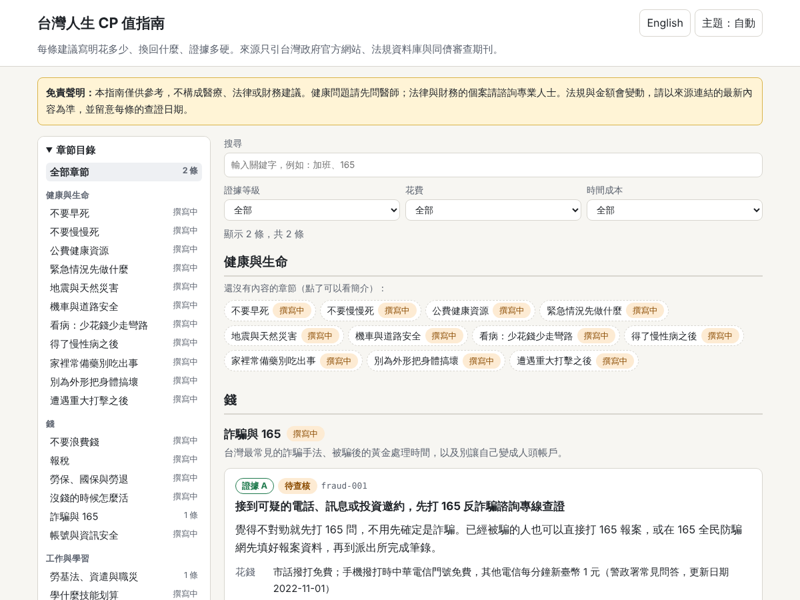
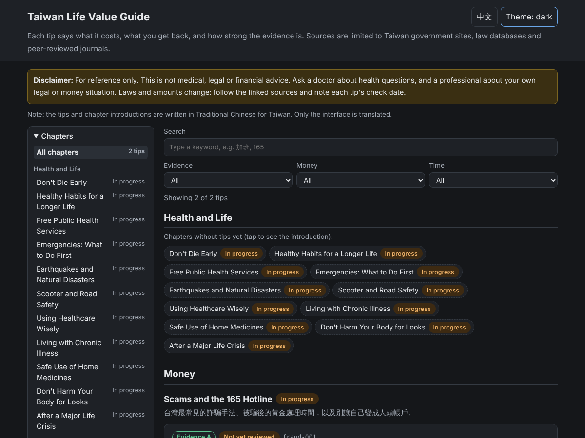
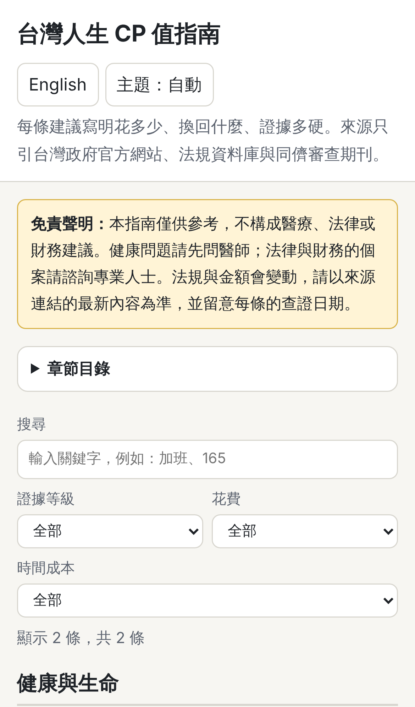

# 台灣人生 CP 值指南

**中文** · [English summary](#english-summary)

每條建議都寫明三件事：要花多少錢、時間和力氣；做了能換回什麼；證據有多硬。內容依台灣的法規、制度與資料撰寫，每條都附上可以點開查證的來源和查證日期。

**線上使用：** https://ckolpeter.github.io/HowToLiveBetter-TW/ （需先在 repo 設定開啟 GitHub Pages）

> **免責聲明**：本指南僅供參考，不構成醫療、法律或財務建議。健康問題請先問醫師；法律與財務的個案請諮詢專業人士。法規與金額會變動，請以來源連結的最新內容為準。



| 深色主題與英文介面 | 手機 |
| --- | --- |
|  |  |

## 功能

- 依 7 個分組、40 個章節瀏覽；還沒有內容的章節標示「撰寫中」
- 搜尋關鍵字，並依證據等級、花費、時間成本篩選
- 每條顯示建議、成本、白話說明、具體數字、證據等級、注意事項、來源連結與查證日期
- 還沒經第二人查核的條目標示「待查核」
- 中英介面切換（條目內容目前只有中文）、淺色／深色／跟隨系統主題
- 單一 HTML 檔，**不需安裝、不需網路**，下載 [`index.html`](index.html) 後雙擊就能用

## 目前進度

第一版骨架：40 章的章節資料都已建立，條目只有 2 條範例（`fraud-001`、`labor-001`），狀態都是草稿。最優先撰寫的 5 章是詐騙與 165（fraud）、勞基法（labor）、公費健康資源（free-health）、機車與道路安全（traffic）、長照 2.0（ltc）。「出國留學」（study-abroad）要不要保留還在討論，標示為「待決定」。

## 寫作規則

1. 使用台灣繁體中文與台灣慣用語。
2. 來源只引用台灣政府官方網站、全國法規資料庫等法規資料庫、同儕審查期刊論文。不引用部落格、新聞或內容農場。
3. 找不到可靠來源的建議就刪除，不用推測填補；不確定時要明講。
4. 數字（金額、比例、年齡門檻、期限）寫清楚適用年度，並附查證日期。
5. 每條都寫「不適用或要注意的人」。健康類提醒先問醫師，法律與財務類提醒個案請諮詢專業人士。

### 證據等級

| 等級 | 意思 |
| --- | --- |
| A | 法律條文、官方公告的制度，或大型隨機對照試驗、系統性回顧 |
| B | 觀察性研究、官方統計資料，以及官方整理的案例與手法說明 |
| C | 專家建議、證據有限或有爭議（要說明爭議在哪） |

## guide.json 格式

所有內容都在 [`guide.json`](guide.json)，上層有三個清單：

```json
{
  "groups":   [{"id": "money", "title": "錢", "title_en": "Money", "order": 2}],
  "chapters": [{"id": "fraud", "title": "詐騙與 165", "title_en": "Scams and the 165 Hotline",
                "intro": "一句話簡介", "order": 16, "group": "money", "status": "writing"}],
  "items":    [ … ]
}
```

章節的 `status`：`planned`（規劃中）、`writing`（撰寫中）、`done`（完成）、`pending`（待決定）。

每條建議的格式：

```json
{
  "id": "章節代號-流水號，例如 labor-001",
  "chapter": "章節代號",
  "title": "一句話建議",
  "cost": {"money": "花多少錢", "time": "花多少時間", "effort": "低/中/高"},
  "plain": "白話說明：做了能換回什麼（1–2 句）",
  "benefit": "研究或官方資料中的具體數字",
  "evidence": "A/B/C",
  "caveats": "不適用或要注意的人",
  "sources": [{"title": "來源名稱", "url": "網址", "type": "官方/法規/期刊", "checked": "YYYY-MM-DD"}],
  "status": "draft（草稿）或 reviewed（已查核）",
  "updated": "最後修改日期 YYYY-MM-DD"
}
```

網頁的「花費」與「時間成本」篩選，是從 `cost.money` 和 `cost.time` 的文字判斷的：花費以「不花錢」「免費」「0 元」開頭算不花錢；時間只寫到分鐘、一通電話或一次的算幾分鐘內，寫到小時、天、每週等算要花較多時間。

## 專案結構

```
guide.json                 分組、章節與所有建議（要新增或修改內容請改這裡）
build.py                   檢查 guide.json 格式，並把資料內嵌進 index.html
index.html                 網頁本體（資料已內嵌，可離線使用）
docs/                      README 用的截圖
.github/workflows/         GitHub Actions：每次 push 和 PR 自動跑 build.py --check
.github/ISSUE_TEMPLATE/    「建議新增條目」與「內容有誤回報」兩個表單
LICENSE                    內容授權：CC BY 4.0
LICENSE-CODE               程式碼授權：MIT
NOTICE.md                  改編出處與授權範圍
CONTRIBUTING.md            參與貢獻說明
```

修改 `guide.json` 後執行（只需要 Python 3，不用裝套件）：

```bash
python build.py          # 檢查並更新 index.html
python build.py --check  # 只檢查，不修改（GitHub Actions 用這個）
```

`build.py` 會擋下：缺欄位或多出欄位、id 格式不對或重複、章節或分組代號不存在、證據等級不是 A/B/C、狀態不在允許的值裡、力氣不是低/中/高、來源類型不對、網址不是完整的 https 網址或不在允許的網域、日期不是 YYYY-MM-DD 或是未來的日期（「今天」以台北時間計算，本機與 GitHub Actions 結果相同）。另外會提醒（不擋）：出現簡體字、數字沒寫年度、C 級沒說明爭議、注意事項沒提醒問醫師或專業人士、查證日期超過一年。

## 參與貢獻

請先看 [CONTRIBUTING.md](CONTRIBUTING.md)，或直接用[表單開 issue](../../issues/new/choose)。

## 出處與授權

本專案改編自 eternity4719 的[《高性价比人生指南》](https://github.com/eternity4719/HowToLiveBetter)（CC BY 4.0），依台灣的法規與制度重寫全部內容，並非原作者的官方版本，也未經原作者審核。原作資訊、參考版本與修改內容詳見 [NOTICE.md](NOTICE.md)。

- 內容（`guide.json` 與文件）：[CC BY 4.0](LICENSE)
- 程式碼（`build.py`、`index.html` 的程式部分、GitHub Actions）：[MIT](LICENSE-CODE)

## English summary

A guide to everyday decisions in Taiwan, rated by cost and evidence. Each tip states what it costs, what you get back, how strong the evidence is, who should be careful, and links to Taiwan government, law-database or peer-reviewed sources with the date they were checked. Adapted from [HowToLiveBetter](https://github.com/eternity4719/HowToLiveBetter) by eternity4719 and rewritten for Taiwan (see [NOTICE.md](NOTICE.md)). Content is licensed under CC BY 4.0 and code under MIT. For reference only; not medical, legal or financial advice.
